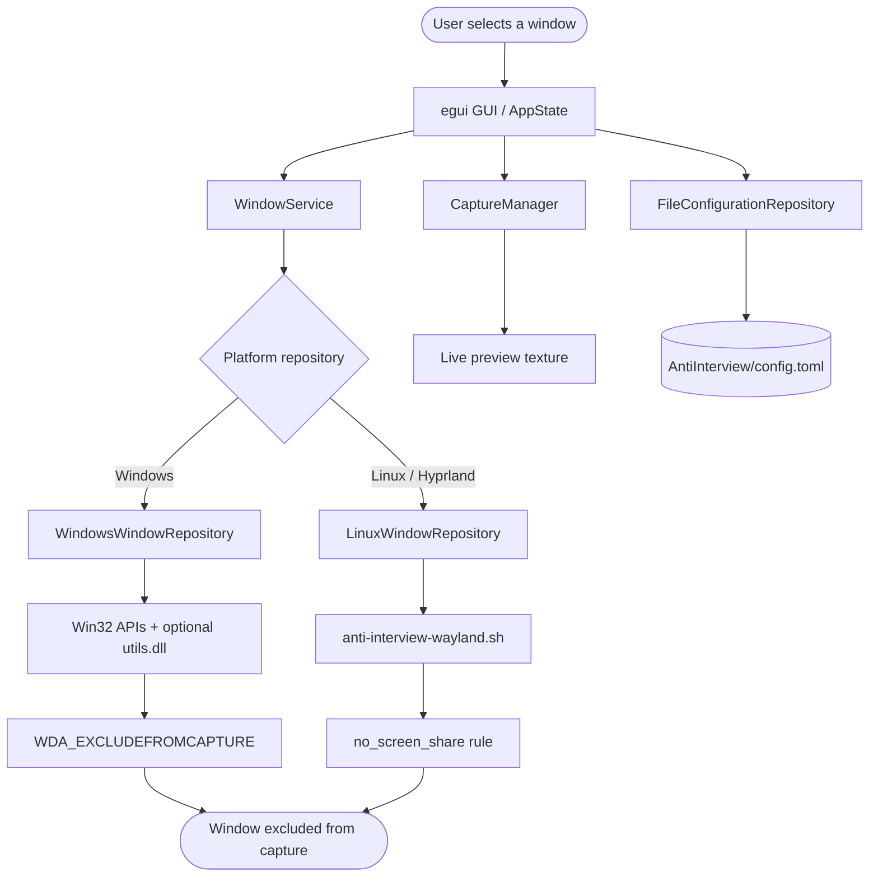
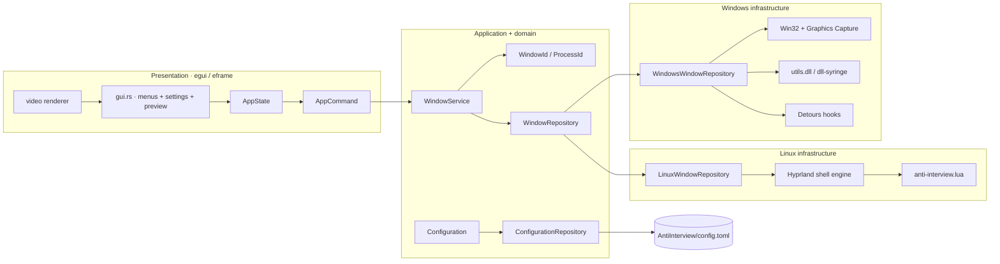
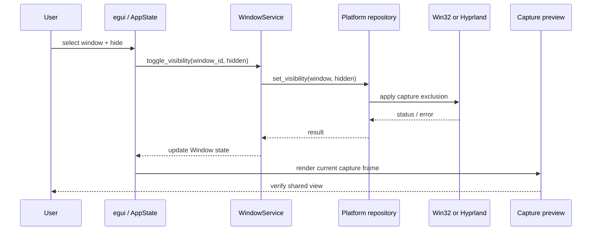
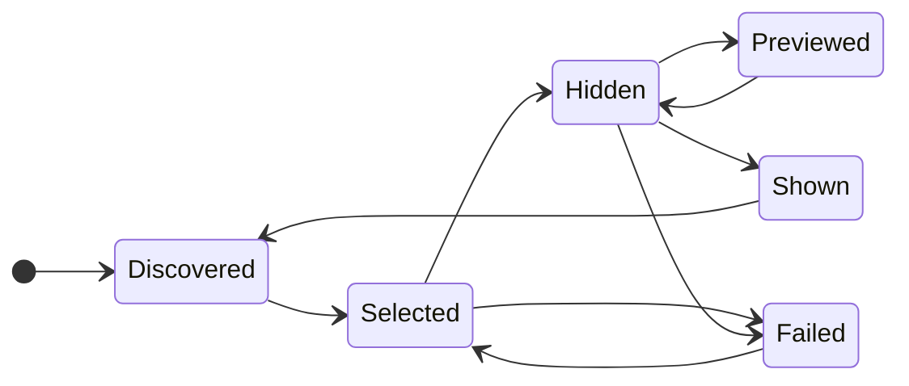
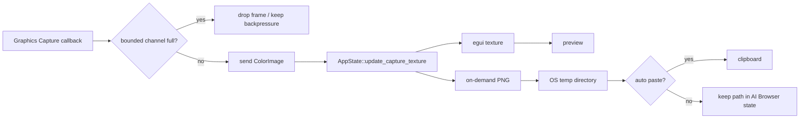
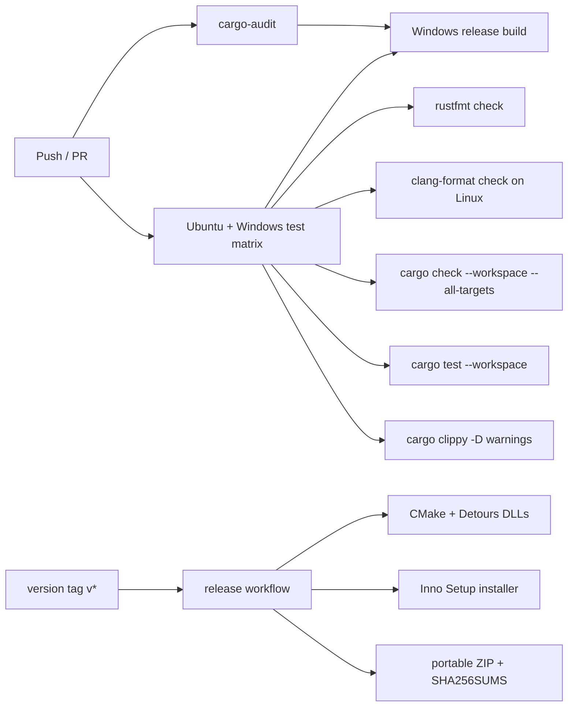
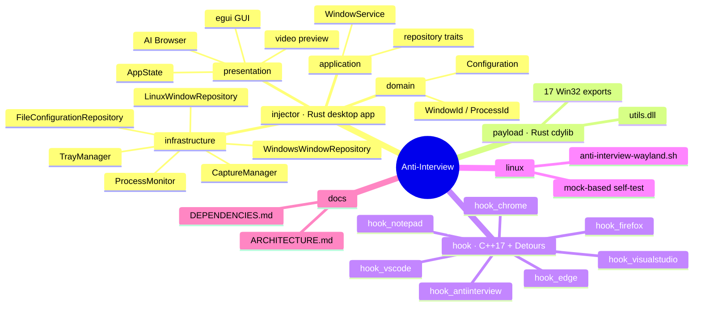

<div align="center">

<h1 align="center">
  
  Anti-Interview
</h1>

A local-first Windows and Linux desktop privacy tool for controlling which application windows appear in screen sharing, recording, and live demonstrations. Built with Rust, egui, Win32, C++, Microsoft Detours, WRY/WebView2, and Hyprland integration.

<p align="center">
  
  
  
  
</p>

**English** · [Português (BR)](README.pt-BR.md)

</div>

---

<h1 align="center">
  
  Demo | Privacy Control Room
</h1>


<p align="center">
  
  
</p>

---

<h1 align="center">
  
  VirusTotal Check
</h1>

<div align="center">
  
  
</div>

> Repository history records one false positive report. Review [SECURITY.md](SECURITY.md) and [PRIVACY.md](PRIVACY.md) before distributing binaries.

---

<h1 align="center">
   Supported Platforms
</h1>

| Capability | Windows | Linux / Hyprland |
|---|---|---|
| Window discovery | Win32 enumeration | `hyprctl clients -j` |
| Exclude selected windows from capture | `SetWindowDisplayAffinity(WDA_EXCLUDEFROMCAPTURE)` and optional DLL path | `no_screen_share` managed Hyprland rules |
| Live desktop preview | Windows Graphics Capture | Explicitly stubbed |
| System tray | Native tray icon | Explicitly stubbed |
| Process hooks | Optional Detours DLLs | Not supported |
| Configuration | TOML under the OS config directory | Same shared TOML repository |
| AI browser | WRY/WebView2 helper executable | Shared UI path; provider/runtime support varies |

> Linux window hiding is a Wayland/Hyprland integration. Its documented ceiling is a black capture box; window shape can still leak. See [`linux/anti-interview-wayland.sh`](linux/anti-interview-wayland.sh).

---

<h1 align="center">How It Works</h1>



---

<h1 align="center">
   Features
</h1>

* **Capture-aware window privacy**: exclude selected windows while keeping them functional on the local desktop.
* **Windows native path**: Win32 enumeration, display affinity, taskbar/Alt+Tab controls, mouse pass-through, opacity, positioning, and window-state operations.
* **Linux / Hyprland path**: list windows, toggle classes, persist managed rules, reload Hyprland, and run an offline self-test.
* **Live preview**: Windows Graphics Capture feeds a bounded two-frame channel and one egui texture, preventing an unbounded capture queue.
* **Silent screenshots**: capture a frame to the OS temporary directory and optionally copy it to the clipboard with `Ctrl+Shift+P`.
* **Integrated AI browser**: open ChatGPT, Antigravity, Gemini, or Claude in the bundled WRY/WebView2 helper; optionally hide it after launch.
* **Task Manager research path**: optional process filtering through seven Microsoft Detours DLLs; disabled by default and documented as experimental.
* **Quick application groups**: Firefox, Edge, Chrome, VS Code, and Visual Studio can be selected from settings.
* **Seven configurable hotkeys**: screenshot, hide window, show GUI, silent screenshot, refresh, preview toggle, and AI browser.
* **System tray**: minimize, restore, or exit without keeping the main window in the taskbar.
* **Multi-monitor support**: choose the active monitor for preview and capture operations.
* **TOML configuration**: typed Rust configuration with Serde defaults preserves compatibility when new fields are absent.
* **DDD boundaries**: domain value types, application use cases, infrastructure adapters, and presentation state stay separated.
* **Zero-cost-oriented Rust**: typed IDs, bounded channels, platform-specific compilation, and no project-operated backend or database.
* **Release packaging**: Windows release workflow builds the Rust binaries, seven hook DLLs, an Inno Setup installer, a portable ZIP, and SHA256SUMS.

---

<h1 align="center">
   Benefits & What It Saves
</h1>

Anti-Interview turns a fragile screen-sharing routine into a repeatable control loop:

| Manual exposure problem | Project benefit | What it saves |
|---|---|---|
| Close or move private windows before a call | Keep windows open and exclude only selected targets | Reopening applications and rearranging workspace |
| Re-check the shared desktop repeatedly | Live preview shows the capture state | Repeated visual verification |
| Hide different tools one by one | Quick groups and remembered hidden-window IDs | Repetitive per-window setup |
| Capture a reference image through a visible tool | Silent screenshot writes to temp and can copy to clipboard | Context switching and extra screenshot software |
| Reconfigure the same privacy choices every session | TOML persistence and auto-refresh | Repeated configuration work |
| Recover from an accidental open AI window | Auto-hide AI Browser after launch | Manual hide/reveal actions |
| Maintain platform-specific scripts manually | Rust repository boundary plus Hyprland managed file | Duplicated control logic |

### Metrics grounded in the repository

These are implementation counts, not marketing claims:

| Metric | Current evidence |
|---|---:|
| Rust workspace crates | 2: `anti-interview` injector + `payload` `cdylib` |
| Supported runtime targets | 2: Windows + Linux/Hyprland |
| Exported native payload functions | 17 Win32 functions in `payload/src/lib.rs` |
| Specialized Detours DLLs | 7 targets in `hook/CMakeLists.txt` |
| Configurable hotkeys | 7 defaults in `domain/configuration.rs` |
| Rust tests | 96 passed in the baseline workspace run |
| Linux shell checks | 16 passed in `linux/test_anti-interview-wayland.sh` |
| CI operating systems | Ubuntu + Windows test matrix |
| Persistent storage | 1 TOML file; no database or public HTTP API |

### Conservative workflow model

The following is an effort model for a CV/project discussion, not a measured benchmark. Actual savings depend on the number of windows and call frequency.

| Routine | Manual approach | With Anti-Interview | Main saving |
|---|---|---|---|
| Prepare a demo with 5 private windows | Close/move and later restore each window | Select remembered windows and toggle visibility | Workspace interruption |
| Validate the shared view | Ask for a second screen or switch tools | Use the live preview | Context switching |
| Capture a reference frame | Open a screenshot tool and copy manually | `Ctrl+Shift+P` | Steps and attention |
| Repeat on Hyprland | Edit rules and reload manually | `on`, `off`, `toggle`, or `clear` | Configuration drift |

---

<h1 align="center">
   Tech Stack
</h1>

<p align="center">
  
</p>

* **Runtime**: Rust nightly `2026-08-04`, Cargo workspace, `anyhow`, `tracing`, `serde`, and TOML.
* **Desktop UI**: `eframe` / `egui` with `egui_extras`, custom animated side panel, themes, GIF/video rendering, and persistence.
* **Windows integration**: Win32 APIs through the `windows` crate, `windows-capture`, `dll-syringe`, native tray support, and process enumeration.
* **Native payload**: Rust `cdylib` compiled as `utils.dll`; exports use `extern "system"` and Win32 handle/types.
* **Hook layer**: C++17, CMake, Microsoft Detours, `ntdll!NtQuerySystemInformation`, `shlwapi`, and `ntdll` linkage.
* **Embedded browser**: WRY/WebView2 helper with `tao`; four fixed HTTPS provider URLs.
* **Clipboard and files**: `arboard`, `dirs`, `image`, `std::fs`, and OS temporary paths.
* **Linux integration**: Bash + `hyprctl` + JSON parsing for Hyprland clients and generated `anti-interview.lua` rules.
* **Quality and delivery**: `rustfmt`, Clippy, Rust tests, `clang-format`, RustSec audit, CMake, Inno Setup, portable ZIP, and SHA256 checksums.

---

<h1 align="center">
  
  Installation & Setup
</h1>

```bash
git clone https://github.com/SobralCybersec/AntiInterview.git
cd AntiInterview
cargo test --workspace
cargo run -p anti-interview
```

### Requirements

- Rust nightly `2026-08-04` with Cargo, `rustfmt`, and Clippy.
- Windows: x64 Windows, Visual Studio C++ tools, CMake, vcpkg, Microsoft Detours, and Inno Setup for the full installer path.
- Linux: a working desktop session, WebKitGTK/GTK development packages required by WRY/egui, and Hyprland plus `hyprctl` for capture exclusion.
- Optional Linux menu picker: `walker`, `wofi`, `rofi`, or `fuzzel`.

### Run (development)

```bash
# Desktop app
cargo run -p anti-interview

# Integrated browser helper smoke check
cargo run -p anti-interview --bin test_wry_browser

# Linux-only offline engine test
bash linux/test_anti-interview-wayland.sh
```

> The main app writes `anti-interview.log`. On Windows, run the application with the privileges required by the selected Win32/DLL operation. The core window-control flow does not require a cloud service, database, or project API.

### Build (release)

```bash
# Rust binaries and payload
cargo build --workspace --release

# Windows hook DLLs; install Detours through vcpkg first
cmake -S hook -B hook/out/build/x64-Release -A x64 \
  -DCMAKE_TOOLCHAIN_FILE="<vcpkg>/scripts/buildsystems/vcpkg.cmake" \
  -DVCPKG_TARGET_TRIPLET=x64-windows
cmake --build hook/out/build/x64-Release --config Release --parallel

# Windows package helper
build_release_package.bat
```

The tagged release workflow runs the locked Rust test/build, builds all hook DLLs, invokes `installer.iss`, creates `anti-interview-v<version>-portable.zip`, and writes `SHA256SUMS.txt`.

### Verify (the exact CI gates, locally)

```bash
cargo fmt --all -- --check
cargo check --workspace --all-targets
cargo test --workspace -- --nocapture
cargo clippy --workspace --all-targets -- -D warnings

# Linux script and C++ formatting checks
bash linux/test_anti-interview-wayland.sh
clang-format --dry-run --Werror hook/*.cpp hook/*.h

# Dependency audit used by GitHub Actions
cargo audit
```

### Configuration

Copy [`config.example.toml`](config.example.toml) as a reference. Runtime configuration is stored at:

```text
dirs::config_dir()/AntiInterview/config.toml
```

The schema covers hotkeys, themes, preview, taskbar/Alt+Tab behavior, mouse input, process hooks, browser quick groups, clipboard behavior, AI Browser auto-hide, refresh cadence, window size, and tray behavior.

### Linux engine commands

```bash
linux/anti-interview-wayland.sh setup
linux/anti-interview-wayland.sh list
linux/anti-interview-wayland.sh status
linux/anti-interview-wayland.sh toggle <class>
linux/anti-interview-wayland.sh on <class>
linux/anti-interview-wayland.sh off <class>
linux/anti-interview-wayland.sh clear
linux/anti-interview-wayland.sh menu
linux/anti-interview-wayland.sh selftest
```

---

<h1 align="center">
  
  Architecture
</h1>

Anti-Interview is a native Rust desktop application. The presentation layer sends typed actions to `AppState`; `WindowService` owns use cases; platform repositories select the Win32 or Hyprland implementation. Optional native capabilities remain behind explicit adapters.



### Screen-share control sequence



### Visibility lifecycle



### Internal contracts

| Boundary | Contract | Owner |
|---|---|---|
| Domain → application | `WindowId`, `ProcessId`, `Window`, `Configuration` | `injector/src/domain` |
| UI → application | `AppCommand`, `WindowService` methods | `injector/src/presentation`, `application` |
| Application → platform | `WindowRepository` trait | `injector/src/application/window_repository.rs` |
| Configuration → disk | `ConfigurationRepository` + TOML | `injector/src/application`, `infrastructure` |
| Rust → native DLL | `extern "system"` payload exports and Win32 handles | `payload/src/lib.rs` |
| Shell → Hyprland | managed Lua rules plus `hyprctl reload` | `linux/anti-interview-wayland.sh` |

### Capture pipeline



### Payload and hook surface

The Rust payload exports window-control operations for visibility, cursor, launch, taskbar, mouse input, opacity, z-order, state, position, rectangle, and taskbar flash. The C++ hook project creates seven specialized DLLs from one CMake function and detours `NtQuerySystemInformation` to filter configured process names in the target process.

| Layer | Build output | Scope |
|---|---|---|
| Rust app | `anti-interview.exe` | UI, orchestration, configuration, capture |
| Browser helper | `ai_browser_window.exe` | WRY/WebView2 window for fixed AI URLs |
| Rust payload | `utils.dll` | 17 exported Win32 window/process helpers |
| C++ hooks | `hook_*.dll` | Notepad, Firefox, Edge, Chrome, VS Code, Visual Studio, Anti-Interview |
| Linux engine | `anti-interview-wayland.sh` | Hyprland rule management and self-test |

---

<h1 align="center">
  
  GitHub Actions CI/CD
</h1>

The repository has two workflows. CI runs on Ubuntu and Windows; tagged releases build the Windows distribution and publish checksums.

### Workflow Matrix

| Workflow / job | Trigger | What it verifies |
|---|---|---|
| `security` | push / PR | RustSec `cargo-audit` on `Cargo.lock` |
| `test` | push / PR, Ubuntu + Windows | format, C++ format, cargo check, tests, Clippy |
| `build` | after security + test | Windows release binary artifact |
| `release` | `v*` tag or dispatch | locked test/build, Detours hooks, installer, portable ZIP, SHA256SUMS |



> CI currently uses unpinned action tags in the workflow files. The useful CV signal is the cross-platform matrix and the explicit Rust/C++/packaging gates, not an unverified supply-chain claim.

---

<h1 align="center">
   Project Structure
</h1>



---

<h1 align="center">
  
  IT Management Objectives → Metrics
</h1>

> This project maps IT-management objectives to observable architecture, controls, and test evidence. Metrics below are repository-backed where stated; effort estimates are explicitly labeled as models.

| # | IT Management objective | How Anti-Interview delivers it | Verifiable metric / evidence |
|---:|---|---|---|
| 1 | **Look at the business.** | Protects sensitive information during meetings, demos, training, and live coding. | Capture-control workflow and use cases in this README. |
| 2 | **Measure the area's performance.** | Logs lifecycle and failure events through structured `tracing`; preview and tests expose operational behavior. | `anti-interview.log` + 96 Rust tests + 16 Linux checks. |
| 3 | **Allocate costs.** | Uses local/open-source components and separates optional Windows capabilities from the shared app. | Rust, C++, CMake, WRY, and OS dependency boundaries are explicit. |
| 4 | **Maintain internal service levels.** | Keeps the core UI/repository flow independent from optional tray, capture, and hook adapters. | Linux stubs preserve shared UI compilation; explicit errors for unsupported operations. |
| 5 | **Reduce cost.** | Reuses the desktop, browser, and local configuration instead of requiring a hosted privacy service. | No project-operated backend, database, or subscription path. |
| 6 | **Optimize structure.** | Applies DDD layers and platform repositories behind `WindowRepository`. | Domain/application/infrastructure/presentation split in `docs/ARCHITECTURE.md`. |
| 7 | **Be agile.** | Small platform adapters and a shell engine allow focused changes without rewriting the UI. | Cargo workspace + separate CMake hook build + standalone Linux self-test. |
| 8 | **Innovate in proposed solutions.** | Combines capture affinity, optional native hooks, a live preview, and Hyprland rules in one local control room. | Windows and Linux implementations share one user-facing workflow. |
| 9 | **Make accurate forecasts.** | Persists refresh cadence and uses bounded capture flow, making operating assumptions explicit. | `refresh_interval_ms`; two-frame bounded channel documented in architecture. |
| 10 | **Do not focus on "commodities."** | Uses mature frameworks for UI and OS plumbing while concentrating custom work on capture privacy and platform adapters. | Custom logic lives in repositories, payload exports, hooks, and Hyprland engine. |
| 11 | **Generate correct information.** | Uses typed IDs, Serde schemas, explicit `Result` paths, and state updates from operation results. | `WindowId`, `ProcessId`, configuration tests, and CI Clippy gate. |
| 12 | **Maintain Business Intelligence.** | Produces local operational evidence through structured logs, test output, and configuration state. | `anti-interview.log`, `cargo test`, shell self-test, and CI artifacts. |
| 13 | **Focus on value actions.** | Tests behavior that matters: configuration defaults, AI browser state, clipboard flow, screenshots, and Hyprland rule transitions. | 96 Rust tests + 16 shell assertions. |
| 14 | **Keep critical processes running.** | Stops/replaces capture handles, bounds frame queues, and clears monitor/capture lifecycle state on drop. | Capture-control thread and bounded channel described in architecture. |
| 15 | **Keep the environment secure.** | Keeps configuration and screenshots local, exposes experimental controls explicitly, and documents misuse boundaries. | [SECURITY.md](SECURITY.md), [PRIVACY.md](PRIVACY.md), local TOML, no server. |
| 16 | **Maintain the infrastructure 24 x 7 x 365.** | Removes cloud availability from the critical path; the desktop app runs locally and the Hyprland engine is scriptable. | No hosted dependency for the core visibility flow. |
| 17 | **Reusable model.** | Reuses repository traits, domain IDs, the capture manager contract, and one Hyprland managed-rule engine. | Windows/Linux adapters implement the same application boundary. |
| 18 | **Win over the business people.** | Presents a visible preview, fast shortcuts, quick groups, tray behavior, and a CV-readable operational story. | Demo section + documented workflow + release packaging. |
| 19 | **Be more efficient, be more effective.** | Avoids unbounded frame work, caches UI assets, uses platform compilation, and validates warnings in CI. | Bounded two-frame capture path; Clippy `-D warnings`. |
| 20 | **Standardize processes.** | Centralizes configuration, repository contracts, shell commands, build gates, and release inputs. | `config.example.toml`, `docs/ARCHITECTURE.md`, CI/release workflows. |
| 21 | **Automate user tasks.** | Auto-refreshes windows, persists selections, auto-hides the AI browser, manages tray behavior, and provides quick application groups. | `auto_refresh`, `hidden_windows`, `auto_hide_ai_browser`, seven hotkeys. |

---

<h1 align="center">
   Usage
</h1>

### Quick Start | Installation

1. Build or download the Windows release.
2. Start `anti-interview.exe` with the privileges required by the selected operation.
3. Open **Windows**, refresh the list, and select the windows to exclude.
4. Start screen sharing and use **Preview** to verify the result.
5. Use **Settings** for groups, hooks, cursor behavior, taskbar behavior, hotkeys, and AI Browser auto-hide.

### Side Menu

- Expand or collapse the animated side panel.
- Use tooltips in collapsed mode.
- Open **Home**, **Windows**, **AI Browser**, **Settings**, and **Credits**.

### Manage Windows

1. Open **Windows**.
2. Filter by title, process, or window metadata.
3. Toggle selected windows.
4. Refresh manually with `Ctrl+Shift+R` or rely on `auto_refresh`.
5. Confirm the shared output in the live preview.

### Settings

#### Interface

- Dark or light theme.
- Hide from taskbar and Alt+Tab.
- Show or hide preview.
- Auto-paste silent screenshots.
- Auto-hide integrated AI Browser.
- Optional banner URL from a local file or trusted HTTPS source.

#### Window behavior

- Ignore mouse input on selected windows.
- Hide cursor where supported.
- Adjust opacity, position, z-order, and window state through the payload test surface.
- Keep the experimental Task Manager path disabled unless researching it.

#### Common applications

- Browsers: Firefox, Microsoft Edge, Google Chrome.
- IDEs: Visual Studio Code, Visual Studio.

#### Process and hook research

- Notepad, Firefox, Edge, Chrome, VS Code, Visual Studio, and Anti-Interview hook DLLs.
- Requires the Windows build and appropriate privileges.
- The hook path is optional, target-specific, and separate from the main capture-affinity flow.

### Keyboard shortcuts

| Shortcut | Action |
|---|---|
| `Ctrl+Shift+S` | Normal screenshot |
| `Ctrl+Shift+P` | Silent screenshot + optional clipboard copy |
| `Ctrl+Shift+H` | Hide selected window |
| `Ctrl+Shift+I` | Show or hide GUI |
| `Ctrl+Shift+R` | Refresh window list |
| `Ctrl+Shift+V` | Toggle live preview |
| `Ctrl+Shift+A` | Open AI Browser |

### Integrated AI Browser

1. Open **AI Browser**.
2. Select ChatGPT, Antigravity, Gemini, or Claude.
3. Click **Open Browser**.
4. Use the helper window for the selected HTTPS provider.
5. Enable **Auto-Hide** if the browser should be excluded after launch.
6. Use `Ctrl+Shift+P` to capture a silent screenshot and optionally copy it.

### System tray

- Close/minimize can move the app to the tray when enabled.
- **Show** restores the UI.
- **Exit** stops capture and closes the application.

---

<h1 align="center">
   Roadmap
</h1>

* [x] Window capture exclusion on Windows
* [x] Linux / Hyprland managed-rule engine
* [x] Live Windows preview
* [x] Multi-monitor selection
* [x] DDD refactor with repository boundaries
* [x] TOML configuration persistence
* [x] Animated GIF/video UI assets
* [x] Expandable animated side menu
* [x] Light/dark themes
* [x] 17 native payload operations
* [x] System tray integration on Windows
* [x] Seven specialized hook DLL targets
* [x] Quick browser and IDE groups
* [x] Integrated AI Browser helper
* [x] Silent screenshot with clipboard option
* [x] AI Browser auto-hide
* [x] Seven configurable hotkeys
* [x] Linux shell self-test with mocked `hyprctl`
* [ ] Hotkey customization UI
* [ ] Saved window profiles
* [ ] Auto-hide rules beyond current groups
* [ ] Start with Windows
* [ ] Broader Linux capture preview support

---

<h1 align="center"> References</h1>

<h2 align="center">

**Windows API**: [SetWindowDisplayAffinity](https://learn.microsoft.com/en-us/windows/win32/api/winuser/nf-winuser-setwindowdisplayaffinity) · [NtQuerySystemInformation](https://learn.microsoft.com/en-us/windows/win32/api/winternl/nf-winternl-ntquerysysteminformation)

</h2>

<h2 align="center">

**Windows capture**: [windows-capture](https://github.com/NiiightmareXD/windows-capture) · [Graphics Capture](https://learn.microsoft.com/en-us/windows/uwp/audio-video-camera/screen-capture)

</h2>

<h2 align="center">

**DLL injection**: [dll-syringe](https://github.com/OpenByteDev/dll-syringe) · [Microsoft Detours](https://github.com/microsoft/Detours)

</h2>

<h2 align="center">

**Rust desktop UI**: [egui](https://github.com/emilk/egui) · [eframe](https://github.com/emilk/egui/tree/master/crates/eframe) · [WRY](https://docs.rs/wry/0.55.0/wry/)

</h2>

<h2 align="center">

**Hyprland**: [hyprctl](https://wiki.hyprland.org/Configuring/Using-hyprctl/) · [window rules](https://wiki.hyprland.org/Configuring/Window-Rules/)

</h2>

<h2 align="center">

**Domain-Driven Design**: [Martin Fowler — Domain-Driven Design](https://martinfowler.com/bliki/DomainDrivenDesign.html)

</h2>

---

<h1 align="center">Limitations, Security & Notes</h1>

### Out of scope

- No project-operated cloud service, database, public HTTP API, or remote telemetry.
- No guarantee that every capture/recording application honors the same OS-level exclusion behavior.
- Linux preview and tray operations are explicit stubs; Linux capture hiding follows Hyprland's rule model.
- The Task Manager/process-hook features are research-oriented optional components, not the primary privacy path.
- The AI Browser embeds fixed provider URLs; it is not an AI API, proxy, or provider integration layer.

### Notes & guarantees

- Configuration is written locally under `AntiInterview/config.toml`.
- Logs are written locally to `anti-interview.log`.
- Silent screenshots use the operating system temporary directory.
- Capture queues are bounded and capture handles are stopped on replacement or drop.
- Unsupported platform operations return explicit errors or narrow shared-UI stubs.
- Read [SECURITY.md](SECURITY.md), [PRIVACY.md](PRIVACY.md), and [CONTRIBUTING.md](CONTRIBUTING.md) before changing or distributing the project.

### Responsible-use note

Use Anti-Interview for privacy, research, education, controlled demonstrations, and protection of sensitive information. Do not use it to deceive interviewers, evade platform controls, conceal unauthorized activity, or violate workplace or service policies. You are responsible for how you use the software and for complying with the rules of every environment where it runs.

---

<h1 align="center">Credits</h1>

<p align="center">
  <strong>Developed and designed by:</strong><br>
  Matheus & Pyetrah (Designer)<br>
  <a href="https://github.com/SobralCybersec">github.com/SobralCybersec</a><br>
  MIT © 2026
</p>

<p align="center">
  <sub>Built with Rust, egui, Win32, WRY/WebView2, C++, Microsoft Detours, and Hyprland.</sub>
</p>
