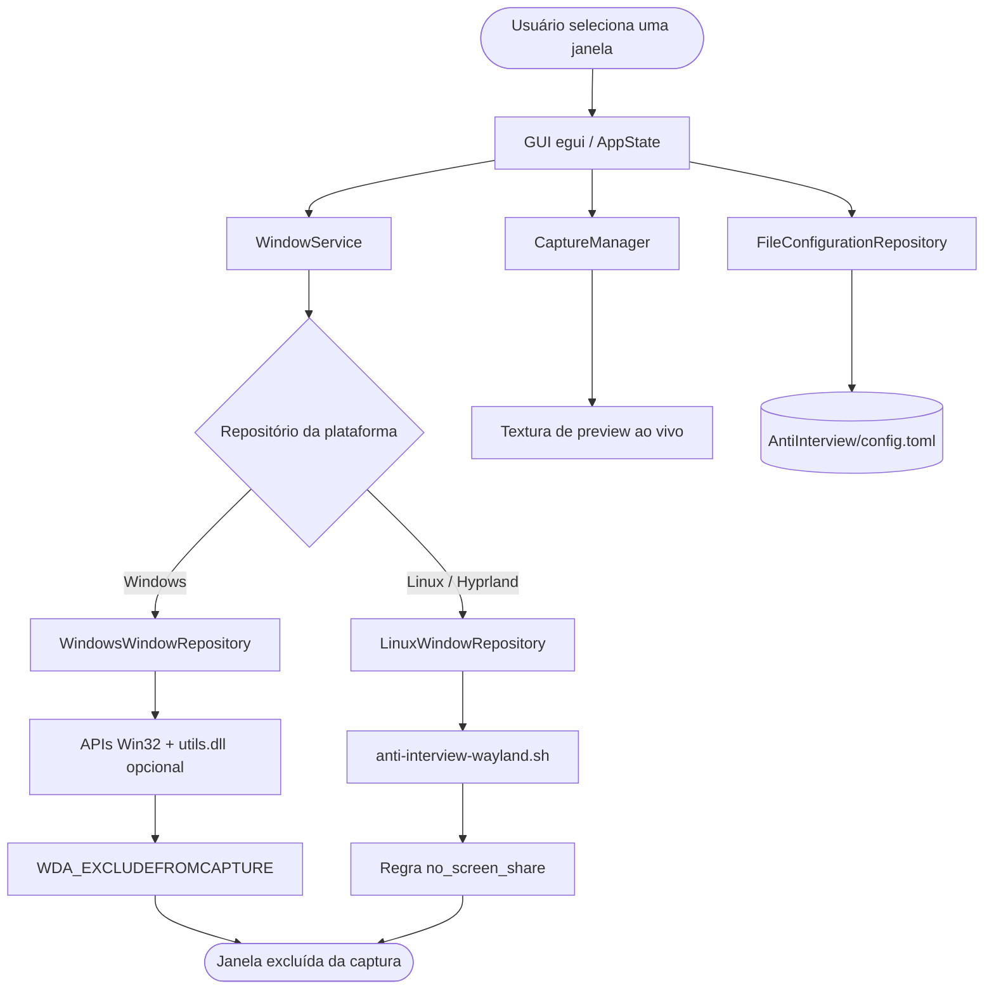
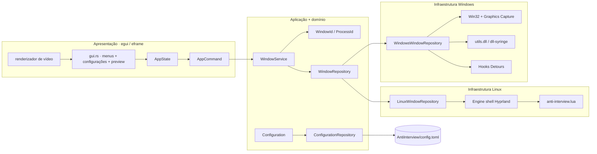
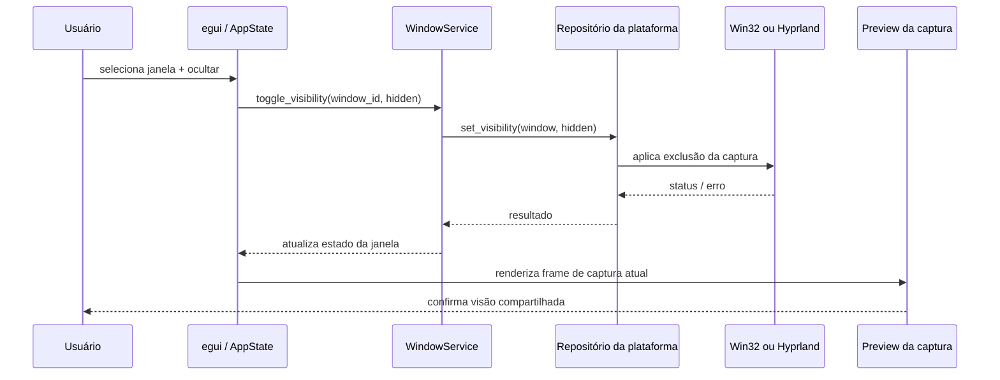
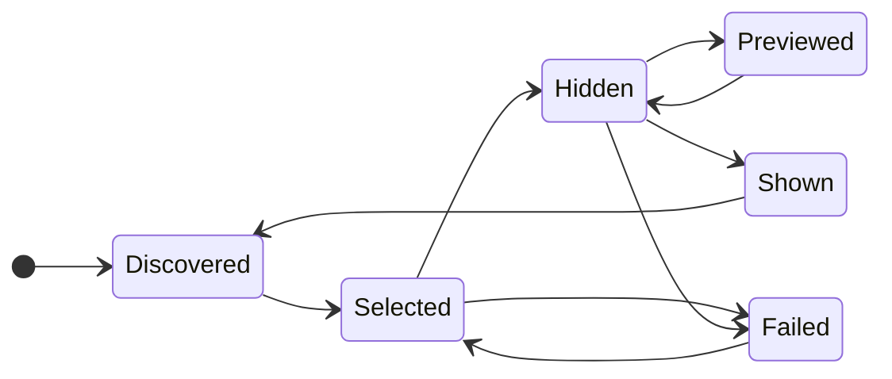
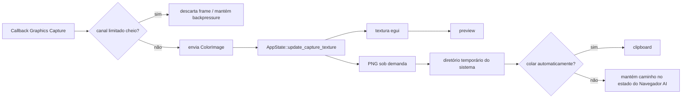
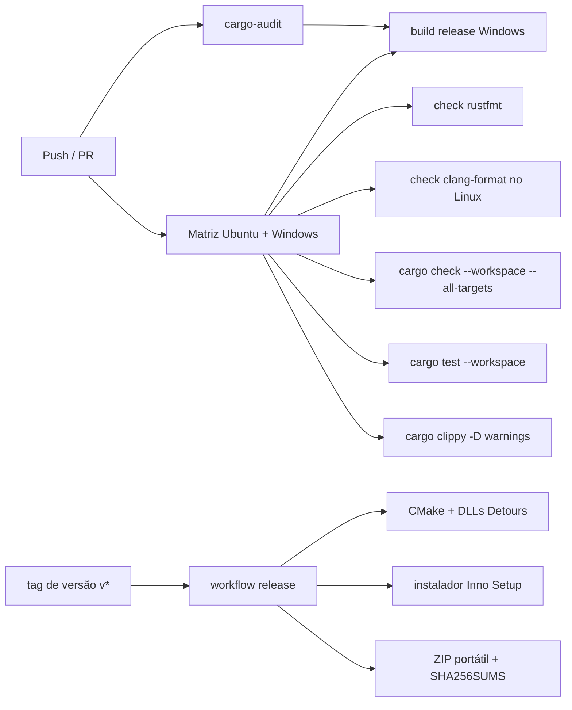
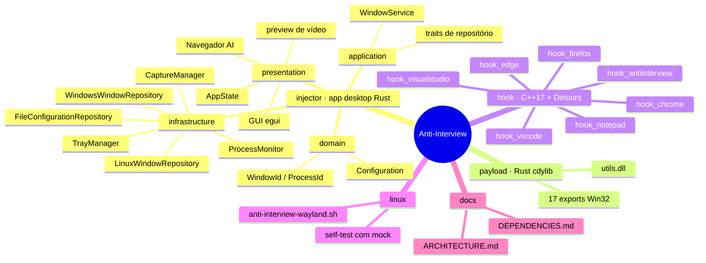

<div align="center">

<h1 align="center">
  
  Anti-Interview
</h1>

Uma ferramenta desktop local-first para Windows e Linux que controla quais janelas de aplicativos aparecem em compartilhamentos de tela, gravações e demonstrações ao vivo. Construída com Rust, egui, Win32, C++, Microsoft Detours, WRY/WebView2 e integração com Hyprland.

<p align="center">
  
  
  
  
</p>

[English](README.md) · **Português (BR)**

</div>

---

<h1 align="center">
  
  Demo | Sala de Controle de Privacidade
</h1>

```
 Anti-Interview v1.2.0                         local-first · sem backend

 ──────────────────────────────────────────────────────────────────────────
   Janelas Windows / Linux                         ● controle de captura pronto
 ──────────────────────────────────────────────────────────────────────────
  ● Firefox   ● VS Code   ● Navegador AI   ● Terminal       [ Atualizar ]
 ──────────────────────────────────────────────────────────────────────────
   Preview ao vivo                                             ● streaming
 ──────────────────────────────────────────────────────────────────────────
  [x] Notas privadas       [ ] Navegador      [x] Dashboard interno
 ──────────────────────────────────────────────────────────────────────────
  [Ocultar selecionadas] [Screenshot silencioso] [Navegador AI] [Config] [Tray]

 ▶ Janelas selecionadas continuam utilizáveis localmente e saem da captura.
```

---

<h1 align="center">
  
  Verificação VirusTotal
</h1>

<div align="center">
  
  
</div>

> O histórico do repositório registra um falso positivo. Consulte [SECURITY.md](SECURITY.md) e [PRIVACY.md](PRIVACY.md) antes de distribuir binários.

---

<h1 align="center">
   Plataformas suportadas
</h1>

| Capacidade | Windows | Linux / Hyprland |
|---|---|---|
| Descoberta de janelas | Enumeração Win32 | `hyprctl clients -j` |
| Excluir janelas selecionadas da captura | `SetWindowDisplayAffinity(WDA_EXCLUDEFROMCAPTURE)` e caminho opcional de DLL | Regras Hyprland gerenciadas com `no_screen_share` |
| Preview desktop ao vivo | Windows Graphics Capture | Explicitamente stubado |
| Bandeja do sistema | Ícone nativo | Explicitamente stubada |
| Hooks de processos | DLLs Detours opcionais | Não suportado |
| Configuração | TOML no diretório de configuração do sistema | Mesmo repositório TOML compartilhado |
| Navegador AI | WRY/WebView2 | Caminho de UI compartilhado; suporte varia por runtime |

> A ocultação no Linux é uma integração Wayland/Hyprland. O limite documentado é uma caixa preta na captura; o formato da janela ainda pode vazar. Consulte [`linux/anti-interview-wayland.sh`](linux/anti-interview-wayland.sh).

---

<h1 align="center">Como funciona</h1>



---

<h1 align="center">
   Funcionalidades
</h1>

* **Privacidade ciente da captura**: exclui janelas selecionadas mantendo-as funcionais na área de trabalho local.
* **Caminho nativo Windows**: enumeração Win32, display affinity, controles da barra de tarefas/Alt+Tab, clique através, opacidade, posição e operações de estado da janela.
* **Caminho Linux / Hyprland**: lista janelas, alterna classes, persiste regras gerenciadas, recarrega o Hyprland e executa um self-test offline.
* **Preview ao vivo**: Windows Graphics Capture alimenta um canal limitado a dois frames e uma textura egui, evitando fila de captura sem limite.
* **Screenshots silenciosos**: captura um frame no diretório temporário do sistema e pode copiá-lo para a área de transferência com `Ctrl+Shift+P`.
* **Navegador AI integrado**: abre ChatGPT, Antigravity, Gemini ou Claude no helper WRY/WebView2; pode ocultá-lo após a abertura.
* **Caminho de pesquisa do Task Manager**: filtragem opcional de processos por sete DLLs Microsoft Detours; desativada por padrão e documentada como experimental.
* **Grupos rápidos de aplicativos**: Firefox, Edge, Chrome, VS Code e Visual Studio podem ser selecionados nas configurações.
* **Sete atalhos configuráveis**: screenshot, ocultar janela, mostrar GUI, screenshot silencioso, atualizar, alternar preview e navegador AI.
* **Bandeja do sistema**: minimizar, restaurar ou sair sem manter a janela principal na barra de tarefas.
* **Multi-monitor**: escolha o monitor ativo para operações de preview e captura.
* **Configuração TOML**: configuração Rust tipada com defaults Serde preserva compatibilidade quando novos campos estão ausentes.
* **Limites DDD**: tipos de domínio, casos de uso da aplicação, adaptadores de infraestrutura e estado de apresentação permanecem separados.
* **Rust orientado a abstrações zero-cost**: IDs tipados, canais limitados, compilação específica por plataforma e nenhum backend ou banco operado pelo projeto.
* **Empacotamento de release**: o workflow de release Windows compila binários Rust, sete DLLs de hook, instalador Inno Setup, ZIP portátil e SHA256SUMS.

---

<h1 align="center">
   Benefícios e o que economiza
</h1>

O Anti-Interview transforma uma rotina frágil de compartilhamento de tela em um ciclo de controle repetível:

| Problema de exposição manual | Benefício do projeto | O que economiza |
|---|---|---|
| Fechar ou mover janelas privadas antes de uma chamada | Mantém janelas abertas e exclui apenas os alvos selecionados | Reabertura de aplicativos e reorganização do workspace |
| Conferir repetidamente a área compartilhada | Preview ao vivo mostra o estado da captura | Verificações visuais repetidas |
| Ocultar ferramentas diferentes uma por uma | Grupos rápidos e IDs de janelas ocultas lembrados | Configuração repetitiva por janela |
| Capturar uma imagem de referência usando uma ferramenta visível | Screenshot silencioso grava no temporário e pode copiar para a área de transferência | Troca de contexto e ferramenta extra |
| Reconfigurar a mesma privacidade em toda sessão | Persistência TOML e atualização automática | Trabalho de configuração repetido |
| Recuperar-se de um navegador AI aberto por acidente | Ocultação automática do navegador AI após a abertura | Ações manuais de ocultar/mostrar |
| Manter scripts específicos de plataforma manualmente | Limite de repositório Rust e arquivo gerenciado do Hyprland | Lógica de controle duplicada |

### Métricas fundamentadas no repositório

Estas são contagens de implementação, não alegações de marketing:

| Métrica | Evidência atual |
|---|---:|
| Crates no workspace Rust | 2: injector `anti-interview` + `cdylib` `payload` |
| Alvos de runtime suportados | 2: Windows + Linux/Hyprland |
| Funções nativas exportadas | 17 funções Win32 em `payload/src/lib.rs` |
| DLLs Detours especializadas | 7 alvos em `hook/CMakeLists.txt` |
| Atalhos configuráveis | 7 defaults em `domain/configuration.rs` |
| Testes Rust | 96 aprovados na execução baseline do workspace |
| Verificações shell Linux | 16 aprovadas em `linux/test_anti-interview-wayland.sh` |
| Sistemas operacionais no CI | Matriz Ubuntu + Windows |
| Armazenamento persistente | 1 arquivo TOML; sem banco ou API HTTP pública |

### Modelo conservador de fluxo

O modelo abaixo estima esforço para discussão de CV/projeto; não é benchmark medido. A economia real depende do número de janelas e da frequência das chamadas.

| Rotina | Abordagem manual | Com Anti-Interview | Principal economia |
|---|---|---|---|
| Preparar uma demo com 5 janelas privadas | Fechar/mover e depois restaurar cada janela | Selecionar janelas lembradas e alternar visibilidade | Interrupção do workspace |
| Validar a visão compartilhada | Pedir uma segunda tela ou trocar de ferramenta | Usar o preview ao vivo | Troca de contexto |
| Capturar um frame de referência | Abrir screenshot e copiar manualmente | `Ctrl+Shift+P` | Etapas e atenção |
| Repetir no Hyprland | Editar regras e recarregar manualmente | `on`, `off`, `toggle` ou `clear` | Deriva de configuração |

---

<h1 align="center">
   Stack tecnológica
</h1>

<p align="center">
  
</p>

* **Runtime**: Rust nightly `2026-08-04`, workspace Cargo, `anyhow`, `tracing`, `serde` e TOML.
* **UI desktop**: `eframe` / `egui` com `egui_extras`, painel lateral animado, temas customizados, renderização de GIF/vídeo e persistência.
* **Integração Windows**: APIs Win32 pela crate `windows`, `windows-capture`, `dll-syringe`, suporte à bandeja nativa e enumeração de processos.
* **Payload nativo**: Rust `cdylib` compilado como `utils.dll`; exports usam `extern "system"` e tipos/handles Win32.
* **Camada de hooks**: C++17, CMake, Microsoft Detours, `ntdll!NtQuerySystemInformation`, `shlwapi` e linkagem com `ntdll`.
* **Navegador embutido**: helper WRY/WebView2 com `tao`; quatro URLs HTTPS fixas de provedores.
* **Clipboard e arquivos**: `arboard`, `dirs`, `image`, `std::fs` e caminhos temporários do sistema operacional.
* **Integração Linux**: Bash + `hyprctl` + parsing JSON para clientes Hyprland e regras `anti-interview.lua` geradas.
* **Qualidade e entrega**: `rustfmt`, Clippy, testes Rust, `clang-format`, auditoria RustSec, CMake, Inno Setup, ZIP portátil e checksums SHA256.

---

<h1 align="center">
  
  Instalação e configuração
</h1>

```bash
git clone https://github.com/SobralCybersec/AntiInterview.git
cd AntiInterview
cargo test --workspace
cargo run -p anti-interview
```

### Requisitos

- Rust nightly `2026-08-04` com Cargo, `rustfmt` e Clippy.
- Windows: Windows x64, ferramentas C++ do Visual Studio, CMake, vcpkg, Microsoft Detours e Inno Setup para o caminho completo do instalador.
- Linux: sessão desktop funcional, pacotes de desenvolvimento WebKitGTK/GTK necessários por WRY/egui e Hyprland com `hyprctl` para exclusão da captura.
- Picker opcional no Linux: `walker`, `wofi`, `rofi` ou `fuzzel`.

### Execução (desenvolvimento)

```bash
# Aplicação desktop
cargo run -p anti-interview

# Smoke check do helper de navegador integrado
cargo run -p anti-interview --bin test_wry_browser

# Teste offline do engine Linux
bash linux/test_anti-interview-wayland.sh
```

> O app principal grava `anti-interview.log`. No Windows, execute a aplicação com os privilégios exigidos pela operação Win32/DLL selecionada. O fluxo central de controle de janelas não exige serviço cloud, banco de dados ou API do projeto.

### Build (release)

```bash
# Binários Rust e payload
cargo build --workspace --release

# DLLs hook Windows; instale Detours pelo vcpkg primeiro
cmake -S hook -B hook/out/build/x64-Release -A x64 \
  -DCMAKE_TOOLCHAIN_FILE="<vcpkg>/scripts/buildsystems/vcpkg.cmake" \
  -DVCPKG_TARGET_TRIPLET=x64-windows
cmake --build hook/out/build/x64-Release --config Release --parallel

# Helper de empacotamento Windows
build_release_package.bat
```

O workflow de release por tag executa o teste/build Rust locked, compila todas as DLLs hook, chama `installer.iss`, cria `anti-interview-v<version>-portable.zip` e grava `SHA256SUMS.txt`.

### Verificação (gates exatos do CI, localmente)

```bash
cargo fmt --all -- --check
cargo check --workspace --all-targets
cargo test --workspace -- --nocapture
cargo clippy --workspace --all-targets -- -D warnings

# Script Linux e checks de formatação C++
bash linux/test_anti-interview-wayland.sh
clang-format --dry-run --Werror hook/*.cpp hook/*.h

# Auditoria de dependências usada pelo GitHub Actions
cargo audit
```

### Configuração

Use [`config.example.toml`](config.example.toml) como referência. A configuração de runtime fica em:

```text
dirs::config_dir()/AntiInterview/config.toml
```

O schema cobre atalhos, temas, preview, comportamento da barra de tarefas/Alt+Tab, entrada do mouse, hooks de processos, grupos rápidos de navegador, clipboard, auto-ocultação do Navegador AI, intervalo de atualização, tamanho da janela e bandeja.

### Comandos do engine Linux

```bash
linux/anti-interview-wayland.sh setup
linux/anti-interview-wayland.sh list
linux/anti-interview-wayland.sh status
linux/anti-interview-wayland.sh toggle <class>
linux/anti-interview-wayland.sh on <class>
linux/anti-interview-wayland.sh off <class>
linux/anti-interview-wayland.sh clear
linux/anti-interview-wayland.sh menu
linux/anti-interview-wayland.sh selftest
```

---

<h1 align="center">
  
  Arquitetura
</h1>

O Anti-Interview é uma aplicação desktop nativa em Rust. A camada de apresentação envia ações tipadas para `AppState`; `WindowService` mantém os casos de uso; os repositórios de plataforma escolhem a implementação Win32 ou Hyprland. Recursos nativos opcionais permanecem atrás de adaptadores explícitos.



### Sequência de controle do compartilhamento



### Ciclo de vida da visibilidade



### Contratos internos

| Limite | Contrato | Responsável |
|---|---|---|
| Domínio → aplicação | `WindowId`, `ProcessId`, `Window`, `Configuration` | `injector/src/domain` |
| UI → aplicação | Métodos de `AppCommand`, `WindowService` | `injector/src/presentation`, `application` |
| Aplicação → plataforma | Trait `WindowRepository` | `injector/src/application/window_repository.rs` |
| Configuração → disco | `ConfigurationRepository` + TOML | `injector/src/application`, `infrastructure` |
| Rust → DLL nativa | Exports `extern "system"` e handles Win32 | `payload/src/lib.rs` |
| Shell → Hyprland | regras Lua gerenciadas e `hyprctl reload` | `linux/anti-interview-wayland.sh` |

### Pipeline de captura



### Superfície de payload e hooks

O payload Rust exporta operações de controle de janela para visibilidade, cursor, inicialização, barra de tarefas, entrada do mouse, opacidade, ordem Z, estado, posição, retângulo e flash na barra de tarefas. O projeto C++ cria sete DLLs especializadas por uma função CMake e faz detour de `NtQuerySystemInformation` para filtrar nomes de processos configurados no processo-alvo.

| Camada | Saída de build | Escopo |
|---|---|---|
| App Rust | `anti-interview.exe` | UI, orquestração, configuração, captura |
| Helper de navegador | `ai_browser_window.exe` | Janela WRY/WebView2 para URLs AI fixas |
| Payload Rust | `utils.dll` | 17 helpers Win32 exportados |
| Hooks C++ | `hook_*.dll` | Notepad, Firefox, Edge, Chrome, VS Code, Visual Studio, Anti-Interview |
| Engine Linux | `anti-interview-wayland.sh` | Gerenciamento de regras Hyprland e self-test |

---

<h1 align="center">
  
  GitHub Actions CI/CD
</h1>

O repositório possui dois workflows. O CI roda no Ubuntu e Windows; releases com tag compilam a distribuição Windows e publicam checksums.

### Matriz de workflows

| Workflow / job | Gatilho | O que verifica |
|---|---|---|
| `security` | push / PR | RustSec `cargo-audit` no `Cargo.lock` |
| `test` | push / PR, Ubuntu + Windows | formatação, C++ format, cargo check, testes, Clippy |
| `build` | após security + test | artefato do binário release Windows |
| `release` | tag `v*` ou dispatch | teste/build locked, hooks Detours, instalador, ZIP portátil, SHA256SUMS |



> O CI atualmente usa tags de actions não fixadas nos arquivos de workflow. O sinal útil para CV é a matriz multiplataforma e os gates explícitos Rust/C++/empacotamento, não uma alegação de supply chain não verificada.

---

<h1 align="center">
   Estrutura do projeto
</h1>



---

<h1 align="center">
  
  Objetivos de Gestão de TI → Métricas
</h1>

> Este projeto relaciona objetivos de gestão de TI a arquitetura, controles e evidências de teste observáveis. As métricas são fundamentadas no repositório quando indicado; estimativas de esforço são identificadas como modelos.

| # | Objetivo de gestão de TI | Como o Anti-Interview entrega | Métrica / evidência verificável |
|---:|---|---|---|
| 1 | **Olhar para o negócio.** | Protege informações sensíveis em reuniões, demos, treinamentos e live coding. | Fluxo de controle de captura e casos de uso neste README. |
| 2 | **Medir o desempenho da área.** | Registra ciclo de vida e falhas com `tracing` estruturado; preview e testes expõem o comportamento operacional. | `anti-interview.log` + 96 testes Rust + 16 checks Linux. |
| 3 | **Alocar custos.** | Usa componentes locais/open source e separa capacidades opcionais do Windows do app compartilhado. | Limites de dependências Rust, C++, CMake, WRY e sistema são explícitos. |
| 4 | **Manter níveis de serviço interno.** | Mantém o fluxo central de UI/repositório independente de adaptadores opcionais de tray, captura e hooks. | Stubs Linux preservam a compilação da UI; operações não suportadas retornam erros explícitos. |
| 5 | **Reduzir custo.** | Reutiliza desktop, navegador e configuração local sem exigir serviço de privacidade hospedado. | Sem backend operado pelo projeto, banco de dados ou assinatura. |
| 6 | **Otimizar estrutura.** | Aplica camadas DDD e repositórios de plataforma atrás de `WindowRepository`. | Separação domínio/aplicação/infraestrutura/apresentação em `docs/ARCHITECTURE.md`. |
| 7 | **Ser ágil.** | Adaptadores pequenos de plataforma e engine shell permitem mudanças focadas sem reescrever a UI. | Workspace Cargo + build CMake separado para hooks + self-test Linux independente. |
| 8 | **Inovar nas soluções propostas.** | Combina capture affinity, hooks nativos opcionais, preview ao vivo e regras Hyprland em uma sala de controle local. | Implementações Windows e Linux compartilham o mesmo fluxo de usuário. |
| 9 | **Fazer previsões acuradas.** | Persiste o ritmo de atualização e usa fluxo de captura limitado, tornando premissas operacionais explícitas. | `refresh_interval_ms`; canal limitado a dois frames documentado na arquitetura. |
| 10 | **Não focar em "commodities".** | Usa frameworks maduros para UI e integração de sistema, concentrando código próprio em privacidade de captura e adaptadores. | Lógica própria em repositórios, exports de payload, hooks e engine Hyprland. |
| 11 | **Gerar informação correta.** | Usa IDs tipados, schemas Serde, caminhos `Result` explícitos e atualizações de estado baseadas nos resultados. | `WindowId`, `ProcessId`, testes de configuração e gate Clippy no CI. |
| 12 | **Manter um Business Intelligence.** | Produz evidência operacional local por logs estruturados, saída de testes e estado de configuração. | `anti-interview.log`, `cargo test`, self-test shell e artefatos CI. |
| 13 | **Focar em ações de valor.** | Testa comportamentos importantes: defaults de configuração, estado do navegador AI, clipboard, screenshots e transições de regras Hyprland. | 96 testes Rust + 16 assertions shell. |
| 14 | **Manter os processos críticos.** | Para/substitui handles de captura, limita filas de frames e limpa estado de monitor/captura no drop. | Thread de controle de captura e canal limitado descritos na arquitetura. |
| 15 | **Manter o ambiente seguro.** | Mantém configuração e screenshots locais, expõe controles experimentais claramente e documenta limites de uso. | [SECURITY.md](SECURITY.md), [PRIVACY.md](PRIVACY.md), TOML local, sem servidor. |
| 16 | **Manter 24 x 7 x 365 toda a infraestrutura.** | Remove disponibilidade cloud do caminho crítico; o app roda localmente e o engine Hyprland é scriptável. | Nenhuma dependência hospedada no fluxo central de visibilidade. |
| 17 | **Modelo reutilizável.** | Reutiliza traits de repositório, IDs de domínio, contrato do gerenciador de captura e um engine de regras Hyprland. | Adaptadores Windows/Linux implementam o mesmo limite da aplicação. |
| 18 | **Conquistar o pessoal do negócio.** | Oferece preview visível, atalhos rápidos, grupos, tray e uma narrativa operacional clara para CV. | Seção de demo + fluxo documentado + empacotamento de release. |
| 19 | **Ser mais eficiente, ser mais eficaz.** | Evita trabalho ilimitado de frames, faz cache de assets, usa compilação por plataforma e valida warnings no CI. | Captura limitada a dois frames; Clippy `-D warnings`. |
| 20 | **Padronizar processos.** | Centraliza configuração, contratos de repositório, comandos shell, gates de build e entradas de release. | `config.example.toml`, `docs/ARCHITECTURE.md`, workflows CI/release. |
| 21 | **Automatizar tarefas dos usuários.** | Atualiza janelas automaticamente, persiste seleções, oculta o navegador AI, gerencia tray e fornece grupos rápidos. | `auto_refresh`, `hidden_windows`, `auto_hide_ai_browser`, sete atalhos. |

---

<h1 align="center">
   Uso
</h1>

### Início rápido | Instalação

1. Compile ou baixe o release Windows.
2. Inicie `anti-interview.exe` com os privilégios exigidos pela operação selecionada.
3. Abra **Janelas**, atualize a lista e selecione as janelas a excluir.
4. Inicie o compartilhamento de tela e use **Preview** para verificar o resultado.
5. Use **Configurações** para grupos, hooks, cursor, barra de tarefas, atalhos e auto-ocultação do Navegador AI.

### Menu lateral

- Expanda ou recolha o painel lateral animado.
- Use tooltips no modo recolhido.
- Abra **Início**, **Janelas**, **Navegador AI**, **Configurações** e **Créditos**.

### Gerenciar janelas

1. Abra **Janelas**.
2. Filtre por título, processo ou metadados da janela.
3. Alterne as janelas selecionadas.
4. Atualize manualmente com `Ctrl+Shift+R` ou use `auto_refresh`.
5. Confirme a saída compartilhada no preview ao vivo.

### Configurações

#### Interface

- Tema escuro ou claro.
- Ocultar da barra de tarefas e Alt+Tab.
- Mostrar ou ocultar preview.
- Colar automaticamente screenshots silenciosos.
- Ocultar automaticamente o Navegador AI integrado.
- URL de banner opcional de arquivo local ou fonte HTTPS confiável.

#### Comportamento de janelas

- Ignorar entrada do mouse nas janelas selecionadas.
- Ocultar cursor quando suportado.
- Ajustar opacidade, posição, ordem Z e estado da janela pela superfície de teste do payload.
- Mantenha o caminho experimental do Task Manager desativado, exceto em pesquisa.

#### Aplicativos comuns

- Navegadores: Firefox, Microsoft Edge, Google Chrome.
- IDEs: Visual Studio Code, Visual Studio.

#### Pesquisa de processos e hooks

- DLLs para Notepad, Firefox, Edge, Chrome, VS Code, Visual Studio e Anti-Interview.
- Exige o build Windows e privilégios adequados.
- O caminho de hooks é opcional, específico por alvo e separado do fluxo principal de capture affinity.

### Atalhos de teclado

| Atalho | Ação |
|---|---|
| `Ctrl+Shift+S` | Screenshot normal |
| `Ctrl+Shift+P` | Screenshot silencioso + cópia opcional para clipboard |
| `Ctrl+Shift+H` | Ocultar janela selecionada |
| `Ctrl+Shift+I` | Mostrar ou ocultar GUI |
| `Ctrl+Shift+R` | Atualizar lista de janelas |
| `Ctrl+Shift+V` | Alternar preview ao vivo |
| `Ctrl+Shift+A` | Abrir Navegador AI |

### Navegador AI integrado

1. Abra **Navegador AI**.
2. Selecione ChatGPT, Antigravity, Gemini ou Claude.
3. Clique em **Abrir Navegador**.
4. Use a janela helper para o provedor HTTPS selecionado.
5. Ative **Auto-Ocultar** se o navegador deve sair da captura após a abertura.
6. Use `Ctrl+Shift+P` para capturar um screenshot silencioso e copiá-lo opcionalmente.

### Bandeja do sistema

- Fechar/minimizar pode mover o app para a bandeja quando habilitado.
- **Mostrar** restaura a UI.
- **Sair** para a captura e fecha a aplicação.

---

<h1 align="center">
   Roadmap
</h1>

* [x] Exclusão da captura de janelas no Windows
* [x] Engine de regras gerenciadas Linux / Hyprland
* [x] Preview Windows ao vivo
* [x] Seleção de múltiplos monitores
* [x] Refatoração DDD com limites de repositório
* [x] Persistência de configuração TOML
* [x] Assets de UI animados em GIF/vídeo
* [x] Menu lateral expansível e animado
* [x] Temas claro/escuro
* [x] 17 operações nativas de payload
* [x] Integração com bandeja no Windows
* [x] Sete alvos de DLLs hook especializadas
* [x] Grupos rápidos de navegadores e IDEs
* [x] Helper de Navegador AI integrado
* [x] Screenshot silencioso com opção de clipboard
* [x] Auto-ocultação do Navegador AI
* [x] Sete atalhos configuráveis
* [x] Self-test shell Linux com `hyprctl` simulado
* [ ] UI para customização de atalhos
* [ ] Perfis salvos de janelas
* [ ] Regras de auto-ocultação além dos grupos atuais
* [ ] Iniciar com o Windows
* [ ] Suporte mais amplo a preview de captura no Linux

---

<h1 align="center"> Referências</h1>

<h2 align="center">

**Windows API**: [SetWindowDisplayAffinity](https://learn.microsoft.com/en-us/windows/win32/api/winuser/nf-winuser-setwindowdisplayaffinity) · [NtQuerySystemInformation](https://learn.microsoft.com/en-us/windows/win32/api/winternl/nf-winternl-ntquerysysteminformation)

</h2>

<h2 align="center">

**Captura Windows**: [windows-capture](https://github.com/NiiightmareXD/windows-capture) · [Graphics Capture](https://learn.microsoft.com/en-us/windows/uwp/audio-video-camera/screen-capture)

</h2>

<h2 align="center">

**Injeção de DLL**: [dll-syringe](https://github.com/OpenByteDev/dll-syringe) · [Microsoft Detours](https://github.com/microsoft/Detours)

</h2>

<h2 align="center">

**UI desktop Rust**: [egui](https://github.com/emilk/egui) · [eframe](https://github.com/emilk/egui/tree/master/crates/eframe) · [WRY](https://docs.rs/wry/0.55.0/wry/)

</h2>

<h2 align="center">

**Hyprland**: [hyprctl](https://wiki.hyprland.org/Configuring/Using-hyprctl/) · [regras de janela](https://wiki.hyprland.org/Configuring/Window-Rules/)

</h2>

<h2 align="center">

**Domain-Driven Design**: [Martin Fowler — Domain-Driven Design](https://martinfowler.com/bliki/DomainDrivenDesign.html)

</h2>

---

<h1 align="center">Limitações, segurança e observações</h1>

### Fora do escopo

- Nenhum serviço cloud, banco de dados, API HTTP pública ou telemetria remota operado pelo projeto.
- Nenhuma garantia de que toda aplicação de captura/gravação respeitará o mesmo comportamento de exclusão do sistema operacional.
- Preview e tray no Linux são stubs explícitos; a ocultação Linux segue o modelo de regras Hyprland.
- Recursos de Task Manager/hooks de processos são componentes opcionais de pesquisa, não o caminho principal de privacidade.
- O Navegador AI incorpora URLs fixas de provedores; não é uma API AI, proxy ou camada de integração de provedor.

### Observações e garantias

- A configuração é gravada localmente em `AntiInterview/config.toml`.
- Logs são gravados localmente em `anti-interview.log`.
- Screenshots silenciosos usam o diretório temporário do sistema operacional.
- Filas de captura são limitadas e handles de captura são parados ao substituir ou descartar.
- Operações não suportadas retornam erros explícitos ou stubs estreitos para a UI compartilhada.
- Leia [SECURITY.md](SECURITY.md), [PRIVACY.md](PRIVACY.md) e [CONTRIBUTING.md](CONTRIBUTING.md) antes de alterar ou distribuir o projeto.

### Uso responsável

Use o Anti-Interview para privacidade, pesquisa, educação, demonstrações controladas e proteção de informações sensíveis. Não o use para enganar entrevistadores, contornar controles de plataformas, ocultar atividade não autorizada ou violar políticas de trabalho ou serviços. Você é responsável pelo uso do software e pelo cumprimento das regras de cada ambiente onde ele for executado.

---

<h1 align="center">Créditos</h1>

<p align="center">
  <strong>Desenvolvido e projetado por:</strong><br>
  Matheus & Pyetrah (Designer)<br>
  <a href="https://github.com/SobralCybersec">github.com/SobralCybersec</a><br>
  MIT © 2026
</p>

<p align="center">
  <sub>Construído com Rust, egui, Win32, WRY/WebView2, C++, Microsoft Detours e Hyprland.</sub>
</p>
